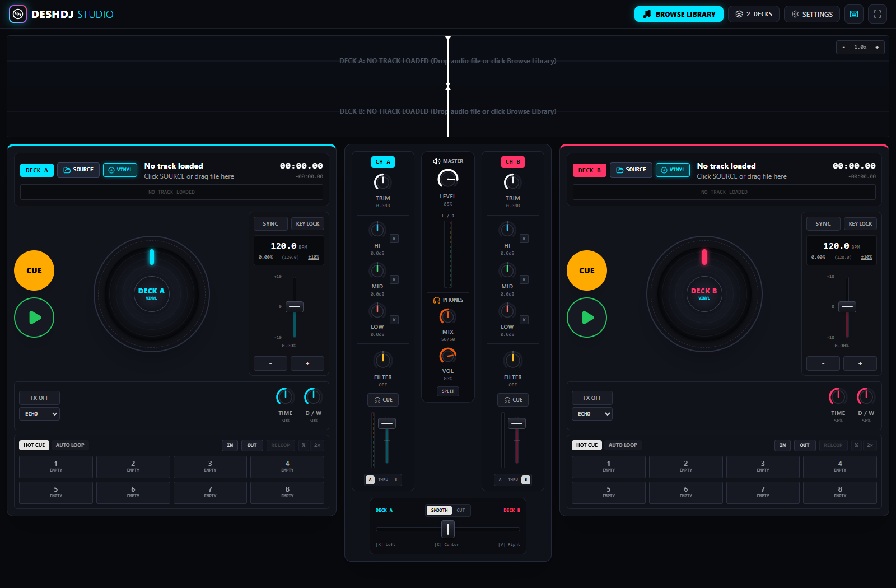
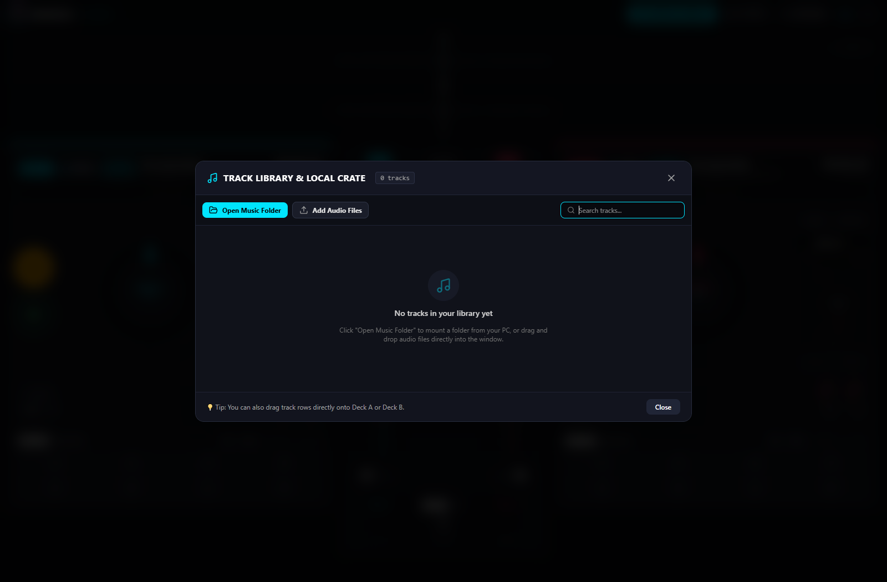
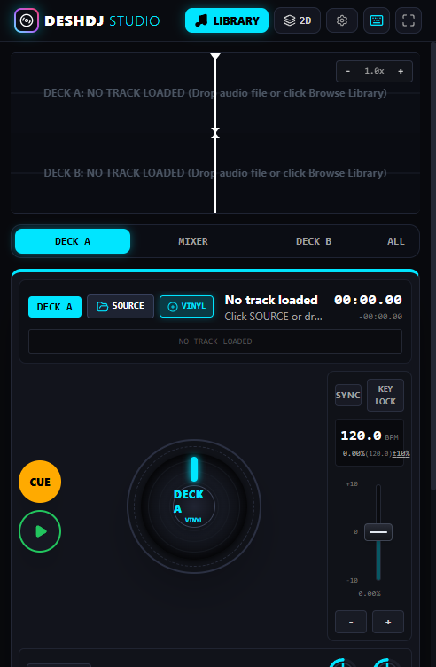
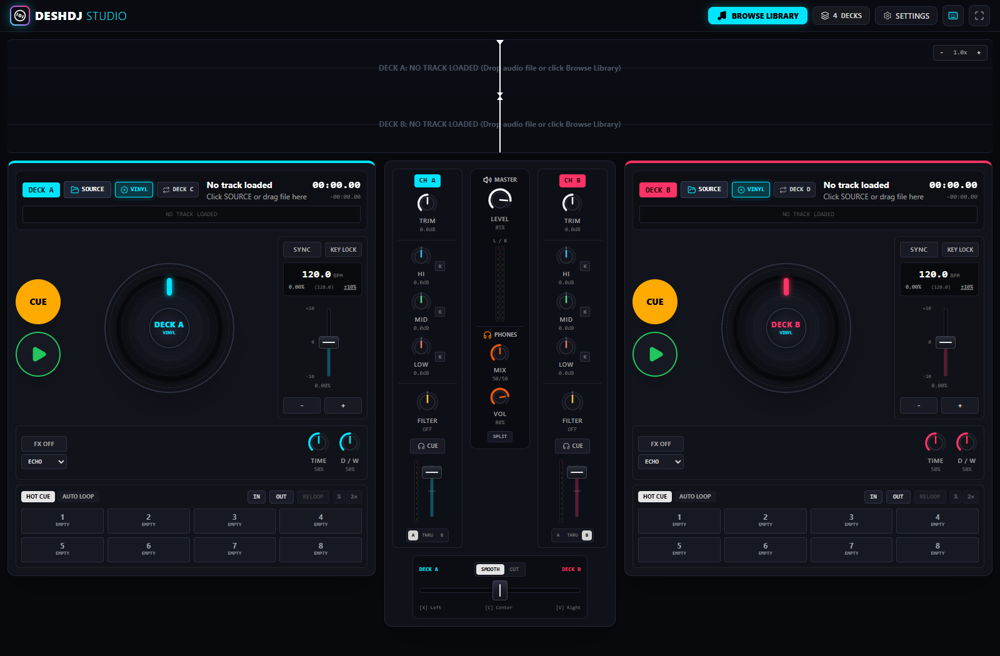
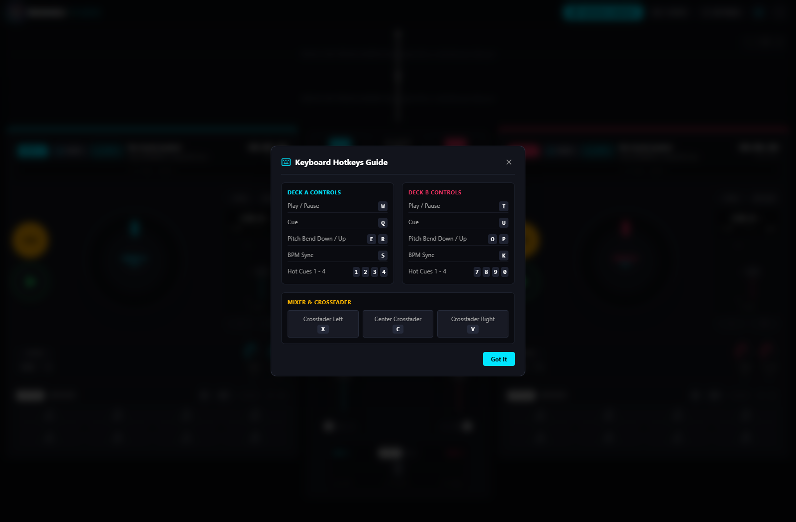

# 🎧 DESHDJ STUDIO

> **Professional Web-Based DJ Mixing Suite with Real-Time Web Audio DSP & Hardware Ergonomics**

[](https://www.typescriptlang.org/)
[](https://react.dev/)
[](https://vitejs.dev/)
[](https://tailwindcss.com/)
[]()
[]()

**DESHDJ Studio** is a browser-based, pro-grade DJ software suite engineered to emulate the tactile workflow, digital signal processing (DSP), and responsiveness of industry-standard Pioneer CDJ multi-players and DJM mixers (e.g. CDJ-3000 & DJM-900NXS2).

---

## 📸 Screenshots

### 🎛️ Main 2-Deck Console Workspace

*Spacious 2-Deck console featuring 60 FPS stacked RGB waveforms, CDJ jog wheels, 3-band EQs, Sound Color filters, Beat FX, and crossfader.*

---

### 📚 Track Library & Local Crate Management

*Mount local music folders from your PC with zero cloud dependency. Features targeted deck loading (`LOAD DECK A` / `LOAD DECK B`) and automatic prioritization of recently selected tracks.*

---

### 📱 Mobile Responsive Performance Mode

*On mobile smartphones and tablets (<1280px), DESHDJ Studio automatically activates an ergonomic segmented view (`[ DECK A ]` `[ MIXER ]` `[ DECK B ]` `[ ALL ]`) with scaled touch platters, large CUE/PLAY buttons, and an instant-access bottom quick-crossfader—with zero changes to the pixel-perfect desktop side-by-side console.*

---

### 🎚️ 4-Deck Performance Mode

*Toggle seamlessly between 2-Deck and 4-Deck mode with dynamic flippable decks ($A \leftrightarrow C$ and $B \leftrightarrow D$).*

---

### ⌨️ Comprehensive Keyboard Hotkeys Guide

*Pioneer CDJ style transport and mixer hotkeys for seamless keyboard performance.*

---

## ✨ Key Features

### 1. 🎛️ Hardware-Grade DJ Audio Engine
- **Post-Fader Beat FX Send/Return ("Echo Out")**: Authentic hardware-routed effects. When you slam the channel volume fader to zero, dry music cuts instantly, but existing delay/reverb repeats continue ringing out smoothly for 5–6 seconds with warm 3200 Hz analog tape damping.
- **4 Studio FX Processors**: Tempo-synced Echo (1/4 to 2 beats), Schroeder Algorithmic Reverb, LFO-modulated Flanger, and Bitcrusher.
- **3-Band Isolator EQ & Kills**: -26 dB cut to +6 dB boost with dead-center 0 dB detents at 12 o'clock, plus instantaneous -70 dB kill switches.
- **Bi-Polar Sound Color Filter**: Smooth high-pass filter when turned right ($> 0$), low-pass filter when turned left ($< 0$), and transparent bypass at center.
- **Dual Crossfader Curves**: Constant-power smooth transition ($\cos/\sin$) and sharp scratch cut mode for turntablists.

---

### 2. 💿 CDJ & Turntable Jog Wheels
- **VINYL Mode**:
  - Touch platter to grab the virtual slipmat and pause playback.
  - Scratch backwards and forwards with authentic transient audio grains.
  - Platter release smoothly resumes playback from the needle release point.
- **CDJ Mode**:
  - Platter touches **never pause playback**.
  - **Momentum-Based Pitch Blend ("Catch the Beat")**: Spinning clockwise temporarily accelerates playback ($\pm 2\%$ to $\pm 20\%$) to catch up and align beats with the other deck. Spinning counter-clockwise decelerates playback.
  - **Natural Friction Decay**: Releasing the jog wheel smoothly glides the tempo back to the pitch slider over ~150–200 ms with zero track jumping or timing glitch.
  - **Frame Search**: When paused, rotating the wheel scrubs the playhead frame-by-frame with transient sound bursts to pinpoint kick drums for cueing.

---

### 3. 🧠 Intelligent Multi-Rate Beat Sync
- **Smart Tempo Matching**: Automatically detects half-time and double-time relationships (e.g., 174 BPM Drum & Bass syncing to 87 BPM at $1.0\times$ rather than $+100\%$).
- **Shortest-Distance Phase Alignment**: Calculates minimal modulo beat phase difference strictly bounded within $[-\frac{\text{beat}}{2}, +\frac{\text{beat}}{2}]$. Snaps to the nearest kick drum without ever leaping full beats away.
- **Master Tempo Tracking**: When Deck A's pitch slider moves, Deck B follows in lockstep if sync is enabled. Moving a synced deck's slider manually disengages sync to return to manual control.
- **Quantized Play**: Pressing `PLAY` on a synced deck starts playback aligned to the exact millisecond phase of the playing master deck.

---

### 4. 🔁 Smart Loop & Pioneer CDJ Dual-Action Out / Exit
- **Dual-Action `OUT / EXIT` Button**:
  - **Inactive**: Clicking `OUT` calculates the duration from `start` to current position, snaps to the nearest integer beat grid (smart beat quantization), and starts looping immediately. If `IN` was not set, it automatically catches the last 4 beats.
  - **Active**: The button transforms into an active amber **`EXIT`** button (`animate-pulse`). Clicking it **exits the loop immediately** and lets the song play forward smoothly past the loop boundary.
- **Interactive `IN` (Loop Cue)**: When loop is active, clicking `IN` acts as a Pioneer CDJ Loop Cue, jumping immediately back to the loop start.
- **`RELOOP` Button**: Displays `${beats}B ACTIVE` during loop; displays `RELOOP` when inactive, allowing you to re-enter the stored loop with one click.
- **Beat Division**: `½` and `2×` buttons halve and double loop length in real time.

---

### 5. 🌊 60 FPS Canvas Stacked Waveforms
- Hardware-accelerated Canvas 2D graphics driven directly by the audio hardware clock (`AudioContext.currentTime`).
- Stacked center alignment with visible playhead needle for instant beat-matching visual feedback.
- 3-Band RGB Frequency Spectrum:
  - **Cyan / White**: High frequencies (hi-hats, snares, transients)
  - **Green / Amber**: Mid frequencies (vocals, synths, leads)
  - **Red / Orange**: Low frequencies (sub-bass, kick drums)
- Full overview mini-waveform with click-to-seek, cue flags, and loop region overlays.

---

### 6. 📁 Local PC Music Storage & Crate Management
- **File System Access API**: Mount local music directories directly from your PC without cloud uploads.
- **Fast ID3 Tag Extraction**: Parses artist, title, album, duration, and embedded album art (`picture[0]`) via `music-metadata-browser`.
- **IndexedDB Persistence**: Track library and pre-extracted waveform peak arrays persist across page reloads via `idb-keyval`.
- **Targeted Deck Source Buttons**: Clicking `SOURCE` on Deck A displays only `LOAD DECK A`; clicking `SOURCE` on Deck B displays only `LOAD DECK B`.
- **Priority Sorting**: The most recently loaded track is sorted to the **#1 position at the top of the table** with a `LAST LOADED` badge for instant access.

---

### 7. 📱 Mobile & Touch Ergonomics
- **Segmented Mobile Views**: Fast 1-tap switching between `[ DECK A ]`, `[ MIXER ]`, `[ DECK B ]`, and `[ ALL ]` stacked mode.
- **Docked Quick-Crossfader**: Always accessible at the bottom of the screen when viewing Deck A or Deck B on mobile, letting DJs perform transitions without constantly switching back to the Mixer tab.
- **Touch Platters**: Responsive jog wheel geometry that scales dynamically from 360px phones to 4K displays without clipping controls.
- **Zero Desktop Regressions**: Desktop screens ($\ge 1280$px / `xl:`) remain 100% untouched, side-by-side, and pixel-perfect.

---

## 🚀 Getting Started

### Prerequisites
- [Node.js](https://nodejs.org/) (version 18.0 or higher recommended)
- A modern Chromium-based browser (Google Chrome, Microsoft Edge, Brave, Opera) supporting the Web Audio API and File System Access API.

### Installation

1. **Clone or navigate to the repository**:
   ```bash
   cd d:/projects/DJ
   ```

2. **Install dependencies**:
   ```bash
   npm install
   ```

### Running the App

1. **Start the local development server**:
   ```bash
   npm run dev
   ```
   Or explicitly bind host and port:
   ```bash
   npm run dev -- --host 127.0.0.1 --port 5173
   ```

2. **Open the application**:
   Navigate to [http://127.0.0.1:5173/](http://127.0.0.1:5173/) in your web browser.

3. **Load your music**:
   - Click **`SOURCE`** on Deck A or Deck B.
   - Click **`Open Music Folder`** to select a music folder from your PC, or drag and drop audio files directly into the window.
   - Click **`LOAD DECK A`** or **`LOAD DECK B`** to load a track onto a deck.

---

## ⌨️ Keyboard Shortcuts Cheat Sheet

| Key | Deck A (Left) | Key | Deck B (Right) |
| :---: | :--- | :---: | :--- |
| **`W`** | Play / Pause | **`I`** | Play / Pause |
| **`Q`** | CDJ Cue (Hold to preview) | **`U`** | CDJ Cue (Hold to preview) |
| **`S`** | Beat Sync (Toggle ON/OFF) | **`K`** | Beat Sync (Toggle ON/OFF) |
| **`E`** | Pitch Bend Down (Nudge -) | **`O`** | Pitch Bend Down (Nudge -) |
| **`R`** | Pitch Bend Up (Nudge +) | **`P`** | Pitch Bend Up (Nudge +) |
| **`D`** | Key Lock (Master Tempo) | **`L`** | Key Lock (Master Tempo) |
| **`1` - `4`**| Hot Cues 1 to 4 | **`7` - `0`**| Hot Cues 1 to 4 |

| Key | Global & Mixer Controls |
| :---: | :--- |
| **`X`** | Crossfader Center |
| **`Z`** | Crossfader Full Left (Deck A) |
| **`C`** | Crossfader Full Right (Deck B) |
| **`B`** / **`Tab`** | Open / Close Track Library |

---

## 🧪 Testing & Verification

Run the Vitest test suite to verify audio DSP math, formatters, BPM detection, and CDJ pitch blend continuity:

```bash
npm test -- --run
```

Execute production build:
```bash
npm run build
```

Preview production build:
```bash
npm run preview
```

---

## 🛠️ Project Structure

```
d:/projects/DJ/
├── screenshots/               # Application UI screenshots
│   ├── deshdj_studio_console.png
│   ├── library_modal.png
│   ├── four_deck_mode.png
│   └── hotkeys_guide.png
├── src/
│   ├── audio/                 # Web Audio API engine & DSP nodes
│   │   ├── effects/           # Echo, Reverb, Flanger, Bitcrusher
│   │   ├── AudioEngine.ts     # Singleton AudioContext, Master/Cue bus routing
│   │   ├── DeckAudioNode.ts   # Per-deck audio node, post-fader send/return FX
│   │   ├── BpmDetector.ts     # Digital kick filter & autocorrelation BPM analysis
│   │   └── WaveformExtractor.ts # 3-band peak envelope generator
│   ├── components/
│   │   ├── common/            # Rotary knobs, vertical faders, VU meters, modals
│   │   ├── deck/              # Jog wheel, pitch fader, performance pads, FX
│   │   ├── header/            # Top bar, branding, 2/4 deck mode switch
│   │   ├── library/           # Track library modal, table crate view
│   │   ├── mixer/             # Physical channel strips, master/cue monitor, crossfader
│   │   └── waveform/          # 60 FPS stacked canvas waveforms, overview bar
│   ├── library/               # File system access & ID3 tag metadata extraction
│   ├── types/                 # TypeScript interfaces for DJ states & tracks
│   ├── utils/                 # Formatters & math utilities
│   ├── App.tsx                # Main application component & central DJ state
│   └── main.tsx               # React 19 entry point
├── AGENT.md                   # Full agent technical knowledge base
├── README.md                  # Project overview & documentation
└── package.json
```

---

## 🌐 Deploying Publicly to aaPanel

**DESHDJ Studio** compiles to a pure, client-side static build requiring zero backend dependencies, Node.js runtime, or databases on your server.

### 1. Pre-Packaged Archive
The production build is packaged and ready to upload:
- Archive: [`deshdj_studio_build.zip`](file:///d:/projects/DJ/deshdj_studio_build.zip) (or the [`dist/`](file:///d:/projects/DJ/dist/) folder).

### 2. Step-by-Step aaPanel Setup
1. **Create the Website in aaPanel**:
   - Go to **Website** in the aaPanel side menu.
   - Click **Add site**.
   - Enter your domain name (e.g., `dj.yourdomain.com`).
   - In **PHP Version**, select **`Pure static`** (no PHP needed).
   - Click **Submit**.

2. **Upload the Build Archive**:
   - In the websites table, click on the site's **Root Directory** link (e.g. `/www/wwwroot/dj.yourdomain.com`).
   - Delete any default `index.html` or `404.html` files.
   - Click **Upload** -> Select `deshdj_studio_build.zip` from this repository.
   - Click **Unzip** -> Extract directly into the root directory.
   - Confirm that `index.html` and the `assets/` folder are located directly in `/www/wwwroot/dj.yourdomain.com/`.

3. **Enable SSL / HTTPS (Required for File System Access API)**:
   - Click on your website name in aaPanel -> Go to the **SSL** tab.
   - Select **Let's Encrypt** -> Check your domain -> Click **Apply**.
   - Turn ON **Force HTTPS**.
   - *Why is HTTPS essential?* Browsers restrict `window.showDirectoryPicker()` (Open Music Folder) to Secure Contexts (`https://`). With HTTPS enabled in aaPanel, users can open music folders directly from their PC on the live public domain.

4. **Nginx Cache & SPA Configuration (Optional)**:
   - Under website settings -> **Config** or **URL rewrite**, add:
     ```nginx
     location / {
         try_files $uri $uri/ /index.html;
     }

     location ~* \.(js|css|png|jpg|jpeg|gif|svg|ico|woff|woff2)$ {
         expires 30d;
         add_header Cache-Control "public, no-transform";
     }
     ```

---

## 📄 License

MIT License. Designed and crafted with precision for DJs and music producers.
